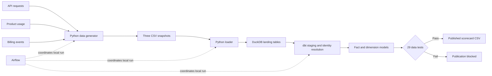

# Platform Usage Analytics Warehouse

### One platform. Three data streams. A scorecard teams can trust.

API traffic, product usage, and billing each tell part of the story. This project brings them into one tested warehouse so Product can follow adoption, Operations can monitor request health, and Finance can analyze billed amounts without mixing currencies or double-counting events.

Built with **Python · DuckDB · dbt · Airflow · Snowflake**.

| 30-day fixture | Raw deliveries | Distinct events | Warehouse | Quality checks |
|---|---:|---:|---:|---:|
| Synthetic platform activity | **252,252** | **252,000** | **8 facts · 12 dimensions** | **29 dbt tests** |

> The counts and results below come from deterministic synthetic data. They describe this portfolio fixture, not a production platform.

## See the project in action

The local demo generates its own source files, builds the warehouse, and publishes a scorecard:

```sh
python pipeline.py run
python explore.py
python drills.py
```

In the guided exploration, customer 0 moves from Basic to Pro on November 16. Compare activity before and after the change, inspect the two raw deliveries for request `api-0`, and trace how duplicates, accepted events, and quarantined records appear in the pipeline.

## How the data moves



The local workflow uses a portable DuckDB file. A separate on-demand deployment sends the same generated CSVs to Snowflake, builds the analytics models there, and compares six scorecard metrics with the local output before publishing a view.

## What the warehouse demonstrates

### Keep business processes at their own grain

Eight fact tables model request attempts, usage events, invoices, payments, credits, sessions, daily usage, and daily billing. Twelve dimensions describe customers, accounts, workspaces, users, dates, plans, features, API endpoints, clients, statuses, event types, and currencies. Separate facts prevent a billing amount from being multiplied when it is analyzed alongside request or usage activity.

### Follow identity and customer history

A source-specific crosswalk maps external account, workspace, and billing IDs to a shared customer. The model joins on both source system and external ID, then matches each event to the customer version valid on its event date. Type 2 history retains plan changes. Unmapped records stay visible in an exception model rather than disappearing silently.

### Make quality part of publishing

The 29 dbt tests cover event uniqueness, fact grain, dimension relationships, valid values, historical ranges, source-to-model counts, and billing and usage reconciliation. A failure drill injects a billing discrepancy; reconciliation catches it and blocks scorecard publication. The last completed scorecard is replaced only after a successful build.

The source files are complete snapshots. A rerun regenerates the same fixture and replaces each landing table, including duplicate deliveries. The Snowflake loader stages each CSV, copies it into a temporary table, checks its row count, and then replaces the corresponding landing table. Each source replacement is separate, so a failure partway through a multi-source load can leave earlier sources committed.

## At a glance

| Example result | Value |
|---|---:|
| Raw source deliveries | 252,252 |
| Distinct source events after deduplication | 252,000 |
| API request attempts | 144,000 |
| API success rate | 97.87% |
| Unmapped usage events retained for review | 30 |
| dbt data tests passed | 29 |

Money is stored as integer cents. The scorecard presents amounts in currency units and keeps currencies separate.

## Run it locally

Requires **Python 3.12** and macOS or Linux. Package installation requires internet access; the pipeline itself runs locally after installation.

```sh
python3.12 -m venv .venv
source .venv/bin/activate
python -m pip install -r requirements.txt
python pipeline.py run
python explore.py
python drills.py
```

The pipeline regenerates the fixed November 1–30, 2025 fixture, replaces this demo's landing tables and models, and writes a new scorecard CSV.

<details>
<summary><strong>Reproduce the four-task Airflow run</strong></summary>

From the project directory, after creating the local `.venv` above:

```sh
export PLATFORM_PROJECT="$PWD"
export PLATFORM_PYTHON="$PWD/.venv/bin/python"
export AIRFLOW_HOME="$PWD/.airflow-home"
export AIRFLOW__CORE__LOAD_EXAMPLES=False
export AIRFLOW__CORE__DAGS_FOLDER="$PWD/dags"

python3.12 -m venv .airflow-env
.airflow-env/bin/pip install 'apache-airflow==3.1.3' --constraint https://raw.githubusercontent.com/apache/airflow/constraints-3.1.3/constraints-3.12.txt
.airflow-env/bin/airflow db migrate
.airflow-env/bin/airflow dags test platform_usage 2025-12-01
```

Airflow and dbt use separate Python environments so their dependencies can be installed independently. The DAG runs manually on one machine and permits one active run. Its logical date identifies the run; the generator always creates the same 30-day historical fixture.
</details>

<details>
<summary><strong>Deploy to Snowflake</strong></summary>

First run the local pipeline so the generated CSVs and comparison scorecard exist. Create a separate Python environment, install `snowflake/requirements.txt`, and copy `.env.example` to `.env`. Set `SNOWFLAKE_ACCOUNT` and `PLATFORM_SNOWFLAKE_KEY` to your account identifier and private-key path, then run:

```sh
set -a
. ./.env
set +a
python snowflake/deploy.py
```

A Snowflake refresh uses warehouse credits. For a new account, create an RSA key pair locally. Put only the base64 public key into `snowflake/01_grant_project_access.sql` where indicated, then run that worksheet once under a role allowed to create roles, a database, schemas, a warehouse, and a user. Keep the private key in a local path excluded from Git.

The loader uploads the three CSVs to a temporary internal stage using `PUT`, then uses `COPY INTO` to load a temporary table per source. After row-count checks, it replaces the matching landing table. dbt builds the `ANALYTICS` schema. The publisher checks all six metrics against the local scorecard before creating the live view. A fresh clone writes its own local Snowflake run evidence.

In a Snowsight worksheet, query the published scorecard with:

```sql
USE WAREHOUSE PLATFORM_USAGE_XS;

SELECT *
FROM PLATFORM_USAGE_LAB.ANALYTICS.PLATFORM_SCORECARD
ORDER BY team, metric, unit;
```
</details>

## Project scope

This is a reproducible portfolio implementation over deterministic synthetic data. It shows how a small analytics pipeline can model multiple business processes, preserve customer history, expose identity gaps, and prevent a failed reconciliation from publishing a misleading scorecard.
